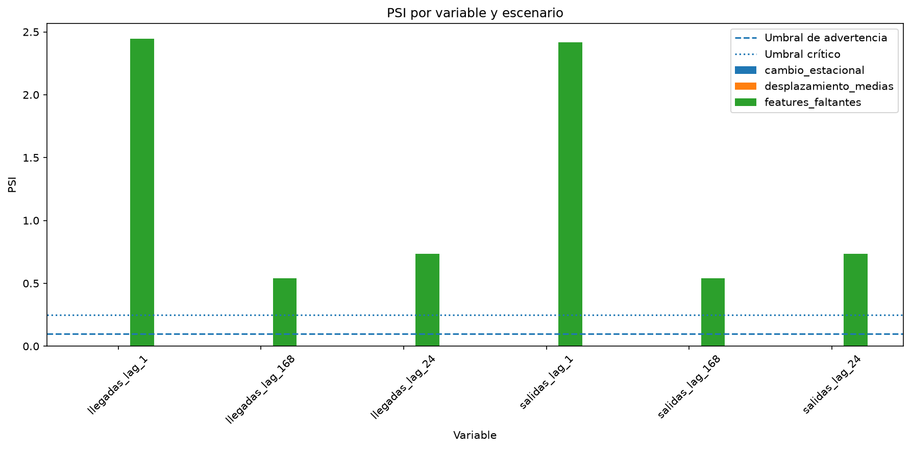
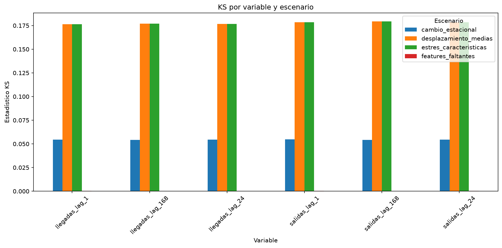
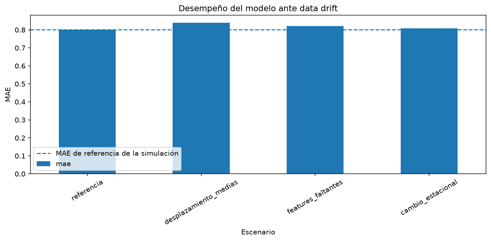

<p align="center">
  
</p>

<p align="center">
  <a href="https://github.com/LUISG47/mibici-demand/actions/workflows/ci.yml"></a>
  
  
  
  
  
  <a href="https://cookiecutter-data-science.drivendata.org/"></a>
  <a href="LICENSE"></a>
  
  
  
  <a href="https://hub.docker.com/r/luisg47/mibici-demand"></a>
</p>

<p align="center"><b>Tecnológico de Monterrey</b> · MLOps (TC5061) · Equipo 1</p>

Pronóstico de demanda de bicicletas por estación y por hora con los
[datos abiertos de MiBici Guadalajara](https://mibici.net/en/open-data/). El objetivo es
anticipar qué estaciones van a quedar vacías o llenas para rebalancear bicicletas a tiempo.

## Índice

- [Equipo](#equipo)
- [Pipeline](#pipeline)
- [Estado del proyecto](#estado-del-proyecto)
  - [Entrega final](#entrega-final-)
- [Reproducir en otro entorno](#reproducir-en-otro-entorno)
- [Configuración y validación](#configuración-y-validación)
- [Fase 2: modelado de principio a fin](#fase-2-modelado-de-principio-a-fin)
- [Instalación](#instalación)
- [Descarga de datos](#descarga-de-datos)
- [Limpieza y versionado de datos con MLflow](#limpieza-y-versionado-de-datos-con-mlflow)
  - [Reglas, en el orden en que se aplican](#reglas-en-el-orden-en-que-se-aplican)
- [Pruebas](#pruebas)
- [Modelo desplegable](#modelo-desplegable)
- [API de predicción](#api-de-predicción)
- [Docker](#docker)
- [Monitoreo de data drift](#monitoreo-de-data-drift)
  - [Resultados con septiembre de 2026](#resultados-con-septiembre-de-2026)
  - [Limitaciones](#limitaciones)
- [Project Organization](#project-organization)

## Equipo

| Integrante | Matrícula | Rol | GitHub |
|---|---|---|---|
| José Luis Lorenzo Augusto Galíndez Vences | A01105695 | Data Engineer / Líder técnico | [@LUISG47](https://github.com/LUISG47) |
| Dante Andreas Cosgaya Morán | A01370354 | Data Scientist | [@dacosgaya](https://github.com/dacosgaya) |
| Héctor Calderón Pérez | A01797600 | Data Scientist / ML Engineer | [@hector-calderon](https://github.com/hector-calderon) |
| Arturo Alejandro Flores Amaro | A01797429 | ML / Software Engineer | [@ArturoAmaro1801](https://github.com/ArturoAmaro1801) |

## Pipeline

```mermaid
flowchart LR
    A["Datos abiertos MiBici<br/>mibici.net"] -->|"descarga<br/>mibici/dataset.py"| B[("data/raw")]
    B -->|"DataCleaner<br/>mibici/cleaning.py"| C[("data/interim<br/>mibici_interim_v1")]
    C -->|"features<br/>mibici/features.py"| D[("data/processed<br/>mibici_processed_v2")]
    C -->|"features v3<br/>mibici/features.py"| E[("data/processed<br/>mibici_processed_v3")]
    E -->|"walk-forward<br/>mibici/modeling/compare_models.py"| F["Modelos<br/>líneas base · Ridge · HGB Poisson"]
    F -->|"champion"| G{{"Model Registry<br/>mibici-demanda-salidas@champion"}}
    G -->|"export<br/>mibici/modeling/export_model.py"| H[("models/<br/>mibici-demanda-salidas-v1")]
    H -->|"cargar_modelo_servicio()"| I["API FastAPI<br/>mibici.api.main"]
    I -->|"Dockerfile"| J["Docker<br/>DockerHub luisg47/mibici-demand"]
    H -->|"simulación y detección<br/>mibici/monitoring/run_drift.py"| K["Monitoreo de data drift<br/>PSI · KS · MAE"]
    E -->|"septiembre 2026"| K
    B -.->|"mibici_raw_v1"| M{{"MLflow · experimento mibici-fase1"}}
    C -.->|"mibici_interim_v1"| M
    D -.->|"mibici_processed_v2"| M
    E -.->|"mibici_processed_v3"| M
    F -.->|"runs por modelo y ventana"| N{{"MLflow · experimento mibici-fase2-modelado"}}
    K -.->|"un run por escenario"| P{{"MLflow · experimento mibici-drift"}}
```



Cada versión del dataset queda registrada en MLflow con su esquema, número de filas, *digest*
y los tags `git_commit` y `fuente_datos`, que la ligan al código y a la fuente que la generaron.

Para generar los datasets procesados:

```bash
# Versión 2: dataset estación-hora con normalización histórica
python -m mibici.features v2

# Versión 3: variables sin escalar y objetivo de la siguiente hora
python -m mibici.features v3
```

<p align="right"><sub><a href="#índice">↑ Volver al índice</a></sub></p>

## Estado del proyecto

| Fase | Estado | Entrega |
|---|---|---|
| Fase 1: datos, EDA y preprocesamiento | ✅ Completada | 25 de octubre de 2026 |
| Fase 2: modelado | ✅ Completada | 6 de noviembre de 2026 |
| Entrega final: pruebas, API, Docker y monitoreo | ✅ Completada | 22 de noviembre de 2026 |

### Entrega final ✅

- [x] Modelo exportado a `models/` y `Dockerfile` (#40, PR #43)
- [x] Pruebas de integración de extremo a extremo (#38, PR #45)
- [x] API con FastAPI: `POST /predict` y `GET /health` (#37, PR #46)
- [x] Publicación de la imagen en [DockerHub](https://hub.docker.com/r/luisg47/mibici-demand) (#40)
- [x] Simulación de data drift y detección de pérdida de performance (#39, PR #48)
- [x] README final y CI con GitHub Actions (#41)

<details>
<summary><b>Fase 2 ✅</b></summary>

- [x] `params.yaml`, validación walk-forward y tracking de MLflow (#26)
- [x] Dataset `mibici_processed_v3` y Pipeline de scikit-learn (#27, #28)
- [x] Parámetros del proyecto en `params.yaml` (#30, #31)
- [x] Líneas base, Ridge y HGB Poisson con ajuste de hiperparámetros, champion en el Model Registry (#32, #34)
- [x] Inferencia con `predict.py` y notebook de modelado (#33, #35, #36)

</details>

<details>
<summary><b>Fase 1 ✅</b></summary>

- [x] Estructura del proyecto con Cookiecutter Data Science
- [x] Ingesta de datos abiertos (`mibici/dataset.py`)
- [x] Diagnóstico de datos crudos (`notebooks/0.1-lg-diagnostico-raw.ipynb`, `reports/diagnostico_raw.md`)
- [x] Limpieza con `DataCleaner` y versionado de datos con MLflow (#4)
- [x] EDA (#14)
- [x] Preprocesamiento y `mibici_processed_v2` (#11, #13, #16)
- [x] Refactor POO y pruebas (#15, #17, #18)
- [x] Reporte PDF Fase 1 (#8)

</details>

Para colaborar, revisa [CONTRIBUTING.md](CONTRIBUTING.md).

<p align="right"><sub><a href="#índice">↑ Volver al índice</a></sub></p>

## Reproducir en otro entorno

Pasos mínimos para verificar el proyecto en una máquina nueva. **Ni las pruebas ni la API
necesitan `data/` ni `mlflow.db`**: las pruebas usan datos sintéticos, fixtures en
`tests/fixtures/` y un MLflow temporal, y la API carga el modelo versionado en
`models/mibici-demanda-salidas-v1/`.

```bash
# 1. Clonar
git clone https://github.com/LUISG47/mibici-demand.git
cd mibici-demand

# 2. Entorno virtual con Python 3.12.2 (la versión del CI y de la imagen Docker)
python3.12 -m venv .venv
source .venv/bin/activate
python --version   # Python 3.12.2

# 3. Dependencias
pip install -r requirements.txt

# 4. Pruebas (182 pruebas, ~1.5 min)
pytest -q
```

Alternativa sin Python local: la imagen publicada en DockerHub levanta la API directamente.

```bash
docker pull luisg47/mibici-demand:v1.0.0
docker run -p 8000:8000 luisg47/mibici-demand:v1.0.0
curl http://localhost:8000/health   # {"estado":"ok","modelo_cargado":true,"detalle":null}
```

Solo para regenerar los datasets, reentrenar o correr el monitoreo de drift con datos reales
hace falta descargar los datos ([Descarga de datos](#descarga-de-datos)).

<p align="right"><sub><a href="#índice">↑ Volver al índice</a></sub></p>

## Configuración y validación

Los parámetros del proyecto (meses de datos, umbrales de limpieza, horizonte, rezagos,
meses de prueba, semilla, hiperparámetros y nombres de MLflow) viven en
[`params.yaml`](params.yaml) y se leen con `cargar_parametros()` de `mibici/config.py`.
Las rutas se siguen calculando en `config.py`.

La validación es **walk-forward con ventana creciente**: para cada mes de prueba
(abril a septiembre de 2026) se entrena con todo lo anterior y se evalúa en ese mes, con
MAE, RMSE y WAPE. Se quita del entrenamiento la última hora antes del mes de prueba,
porque su objetivo (la siguiente hora) ya cae en la prueba.

```python
from mibici.modeling.validation import WalkForwardSplitter, evaluar_walk_forward
from mibici.modeling.tracking import configurar_mlflow, registrar_evaluacion

splitter = WalkForwardSplitter.desde_parametros()  # también sirve como cv= en GridSearchCV
tabla, resumen = evaluar_walk_forward(pipeline, X, y, splitter)

configurar_mlflow()  # experimento mibici-fase2-modelado
run_id = registrar_evaluacion("ridge", tabla, resumen, hiperparametros)
```

En MLflow cada modelo tiene un run padre con las métricas promedio y un run anidado por
ventana. `registrar_modelo(run_id, ..., alias="champion")` lo registra como
`mibici-demanda-salidas` y se carga con `models:/mibici-demanda-salidas@champion`.

<p align="right"><sub><a href="#índice">↑ Volver al índice</a></sub></p>

## Fase 2: modelado de principio a fin

Objetivo: predecir las salidas de cada estación en la siguiente hora. Con el `.venv`
activado y los viajes limpios en `data/interim/` (ver
[Limpieza y versionado](#limpieza-y-versionado-de-datos-con-mlflow)):

```bash
# 1. Dataset v3: variables sin escalar y objetivo de la siguiente hora
#    (data/processed/estacion_hora_v3.parquet, registrado como mibici_processed_v3)
python -m mibici.features v3

# 2. Comparar modelos y registrar el champion
python -m mibici.modeling.compare_models

# 3. Predecir con el champion (data/processed/predicciones.parquet)
python -m mibici.modeling.predict

# 4. Revisar runs, métricas y Model Registry (http://127.0.0.1:5000)
mlflow ui --backend-store-uri sqlite:///$PWD/mlflow.db
```

- **`compare_models`** evalúa con walk-forward (abril a septiembre de 2026) las dos líneas
  base (misma hora de la semana anterior y media por estación × día × hora), Ridge y
  HistGradientBoosting con pérdida Poisson. Ridge y HGB se ajustan dentro de cada ventana
  con el espacio de `params.yaml`. Cada modelo queda en el experimento
  `mibici-fase2-modelado` con un run padre (métricas promedio e hiperparámetros más
  elegidos) y un run anidado por ventana. El de menor MAE promedio se entrena con todo el
  periodo y se registra como `mibici-demanda-salidas@champion`.
- La corrida completa tarda unos 20 minutos y usa hasta ~9 GB de RAM. El avance del HGB se
  guarda en `data/processed/checkpoints_hgb/`; si se interrumpe, se puede volver a correr y
  continúa donde se quedó.
- **`predict`** carga `models:/<modelo_registrado>@champion` (nombre de `params.yaml`) y
  guarda `estacion_id`, `fecha_hora`, `fecha_objetivo`, las salidas reales (si vienen en
  los datos) y las predichas, recortadas en 0. Acepta `--datos-path`, `--salida-path`
  (`.parquet` o `.csv`), `--alias`, `--modelo-nombre` y `--modelo-dir` (usa un modelo
  exportado en `models/` en lugar del Registry; ver [Modelo desplegable](#modelo-desplegable)).
- El notebook [`notebooks/2.0-aaf-modelado.ipynb`](notebooks/2.0-aaf-modelado.ipynb)
  muestra la comparación registrada en MLflow y predice con el champion; se ejecuta
  después del paso 2.

<p align="right"><sub><a href="#índice">↑ Volver al índice</a></sub></p>

## Instalación

```bash
python3 -m venv .venv
source .venv/bin/activate
pip install -r requirements.txt
```

<p align="right"><sub><a href="#índice">↑ Volver al índice</a></sub></p>

## Descarga de datos

Los datos vienen de los [datos abiertos de MiBici](https://mibici.net/en/open-data/) y **no se
suben a Git**. Para bajarlos a `data/raw/` (con el `.venv` activado):

```bash
# Rango por defecto: 2025-10 a 2026-09
python mibici/dataset.py

# Otro rango de meses (formato AAAA-MM, ambos inclusive)
python mibici/dataset.py --inicio 2025-01 --fin 2025-06

# Equivalente con make (usa el rango por defecto)
make data
```

- Baja un CSV de viajes por mes (`datos_abiertos_AAAA_MM.csv`) y el CSV de nomenclatura de
  estaciones (`nomenclatura_AAAA_MM.csv`).
- Los enlaces se extraen de la página de datos abiertos, porque no siguen un patrón fijo.
- Omite los archivos que ya están descargados, así que se puede volver a correr sin problema.
- Avisa en consola qué meses del rango no tienen enlace (por ejemplo, meses aún no publicados).
- Las carpetas de `data/` se crean solas la primera vez (`mibici/config.py`).
- También se puede usar desde Python: `from mibici.dataset import descargar_meses`.

<p align="right"><sub><a href="#índice">↑ Volver al índice</a></sub></p>

## Limpieza y versionado de datos con MLflow

```bash
python -m mibici.cleaning                                  # limpia y registra en MLflow
mlflow ui --backend-store-uri sqlite:///$PWD/mlflow.db     # abrir http://127.0.0.1:5000
```

El script lee todos los CSV de `data/raw/`, aplica la clase `DataCleaner` (`mibici/cleaning.py`)
y guarda el resultado en `data/interim/viajes_limpios.parquet`. Todo queda en el experimento
**`mibici-fase1`** de MLflow (base `mlflow.db` y artefactos en `mlruns/`, ambos fuera de Git):

- Dataset crudo **`mibici_raw_v1`** (`context="raw"`) y dataset limpio **`mibici_interim_v1`**
  (`context="interim"`), con su esquema, número de filas y *digest* para detectar cambios.
- Parámetros: meses procesados y filas antes y después.
- Artefacto `bitacora_limpieza.csv`: por cada regla, filas antes, después y afectadas.
- Artefacto `datos/viajes_limpios.parquet`: copia del dataset limpio (~96 MB por corrida). El
  crudo no se guarda porque se reconstruye con `mibici/dataset.py`.
- Tags que ligan cada versión de los datos con su origen: `git_commit` (hash del código que la
  generó), `git_cambios_sin_commit` (`true` si se corrió con cambios sin commit, en cuyo caso
  el hash no describe exactamente el código) y `fuente_datos` (URL de los datos abiertos).

Para que `git_commit` sea confiable, haz commit de tus cambios **antes** de correr la limpieza.

### Reglas, en el orden en que se aplican

Los números vienen del diagnóstico (`reports/diagnostico_raw.md`). En la lectura, cada archivo
se abre como UTF-8 y, si falla, como Latin-1 (caso de 2026-01).

| # | Regla (método) | Qué hace | Por qué |
|---|---|---|---|
| 1 | `eliminar_duplicados` | Quita filas idénticas | 758 filas repetidas en 2026-09; contarían doble la demanda |
| 2 | `parsear_fechas` | Inicio y fin a datetime, agrega `duracion_min` | Las reglas de duración y el conteo por hora lo necesitan |
| 3 | `eliminar_duracion_cero` | Quita viajes de 0 segundos | Terminan en el mismo instante en que empiezan: no son viajes |
| 4 | `eliminar_cortos_misma_estacion` | Quita viajes < 1 min con origen = destino | La bici se sacó y se devolvió de inmediato (anclaje fallido o arrepentimiento); no es demanda real |
| 5 | `eliminar_mas_de_24h` | Quita viajes de más de 24 h | Bicicletas no devueltas o errores de registro (13 viajes, máximo 98 h) |
| 6 | `marcar_duracion_atipica` | `duracion_atipica = True` si dura de 3 a 24 h | Son raros (p99.9 = 59 min) pero la salida sí ocurrió; se conservan y se pueden excluir en el EDA |
| 7 | `anio_nacimiento_invalido_a_nulo` | Año < 1920 pasa a nulo | Años imposibles (199, 1420); el viaje es válido, solo el dato del usuario no |
| 8 | `genero_nulo_a_desconocido` | Género vacío pasa a `"desconocido"` | Conserva los viajes (0.7%) y deja explícita la categoría |
| 9 | `marcar_estaciones_en_catalogo` | `estacion_en_catalogo = True` si origen y destino están en la nomenclatura | Las estaciones 405 y 407 no están en el catálogo pero tuvieron viajes reales (junio y julio 2026); se conservan |

En las reglas que marcan o corrigen, "filas afectadas" en la bitácora cuenta las filas
modificadas; en la regla 9 cuenta los viajes **fuera** del catálogo.

Resultado con 2025-10 a 2026-09: **4,497,877 → 4,354,416 viajes** (se elimina el 3.2%).

<p align="right"><sub><a href="#índice">↑ Volver al índice</a></sub></p>

## Pruebas

Todas las pruebas corren con un solo comando desde la raíz del repo (con el `.venv`
activado). **No necesitan `data/` ni `mlflow.db`**: usan datos sintéticos, fixtures
pequeños en `tests/fixtures/` y un MLflow temporal en cada prueba, así que también
corren en un clon limpio y en el CI.

```bash
pytest -q        # las 182 pruebas (~1.5 min en un clon limpio)
make lint        # ruff: formato e imports
make test        # equivalente a python -m pytest tests
```

| Grupo | Archivos | Qué cubre |
|---|---|---|
| Datos | `test_cleaning.py`, `test_diagnostics.py`, `test_eda.py`, `test_features.py`, `test_plots.py` | Reglas de `DataCleaner`, diagnóstico de crudos, EDA, agregación estación-hora (v2 y v3) y gráficas |
| Modelado | `test_modeling_pipeline.py`, `test_baselines.py`, `test_validation.py`, `test_tuning.py`, `test_checkpoints.py` | Pipeline de scikit-learn, líneas base, walk-forward y métricas, ajuste de hiperparámetros y checkpoints |
| Evaluación | `test_compare_models.py`, `test_error_analysis.py`, `test_error_plots.py` | Comparación de modelos y elección del champion, análisis y figuras de errores |
| MLflow | `test_tracking.py`, `test_predict.py` | Runs padre y anidados, Model Registry con alias, inferencia y CLI de `predict` |
| Serving | `test_export_model.py`, `test_api.py` | Exportación a `models/` con `metadata.json`, reproducibilidad del modelo v1 (tolerancia 1e-9) y endpoints `/health` y `/predict` (12 pruebas) |
| Integración | `integration/test_e2e.py` | Flujo de extremo a extremo con MLflow temporal: datos, features v3, entrenamiento, predicción, métricas, registro y reproducibilidad del modelo guardado |
| Monitoreo | `test_drift.py` | Simulación de escenarios, PSI y KS, métricas, alertas, gráficas y tracking del drift (39 pruebas) |

El workflow [`.github/workflows/ci.yml`](.github/workflows/ci.yml) corre `make lint` y
`pytest -q` con Python 3.12.2 en cada Pull Request y en cada push a `main`.

<p align="right"><sub><a href="#índice">↑ Volver al índice</a></sub></p>

## Modelo desplegable

El modelo que se sirve es **`models:/mibici-demanda-salidas/1`**: el champion de la
Fase 2 (HistGradientBoosting con pérdida Poisson, MAE promedio 0.750 en el walk-forward
de abril a septiembre de 2026). Está exportado como modelo MLflow en
[`models/mibici-demanda-salidas-v1/`](models/mibici-demanda-salidas-v1/), que **sí se
versiona en Git** (1.8 MB): así cualquiera que clone el repo, el CI y la imagen Docker lo
tienen sin acceso a nuestro `mlflow.db` local.

| Archivo | Contenido |
|---|---|
| `MLmodel`, `model.pkl` | Modelo MLflow (Pipeline de scikit-learn serializado con cloudpickle) y su firma de 20 columnas |
| `requirements.txt`, `conda.yaml`, `python_env.yaml` | Entorno con el que se entrenó |
| `input_example.json`, `serving_input_example.json` | Ejemplos de entrada |
| `metadata.json` | URI y versión del modelo, `run_id`, métricas promedio, hiperparámetros, `git_commit` del entrenamiento y de la exportación, `fecha_exportacion`, `columnas_entrada` y `sha256_model_pkl` |

Para exportarlo de nuevo desde el Model Registry (necesita `mlflow.db`):

```bash
python -m mibici.modeling.export_model                 # usa la sección serving: de params.yaml
python -m mibici.modeling.export_model --sobrescribir  # si la carpeta ya existe
```

Desde Python, `cargar_modelo_servicio()` de `mibici/modeling/predict.py` carga el modelo
según `serving.fuente` de `params.yaml`: `local` (la carpeta de `models/`, lo que usa
Docker) o `registry` (`models:/<nombre>/<versión>`).

<p align="right"><sub><a href="#índice">↑ Volver al índice</a></sub></p>

## API de predicción

Servicio FastAPI en [`mibici/api/`](mibici/api/) (`main.py` y `schemas.py`). Carga el
modelo una sola vez al iniciar con `cargar_modelo_servicio()` (por defecto la carpeta de
`models/`, así que no necesita `mlflow.db`). Título, versión y tamaño máximo del lote
salen de la sección `api:` de `params.yaml`.

```bash
uvicorn mibici.api.main:app --port 8000   # documentación interactiva en http://localhost:8000/docs
```

| Endpoint | Qué hace | Respuestas |
|---|---|---|
| `GET /health` | Estado del servicio y del modelo; lo usa el `HEALTHCHECK` de Docker | `200` modelo listo · `503` el modelo no cargó |
| `POST /predict` | Salidas de cada estación en la siguiente hora para un lote de registros | `200` predicciones · `422` entrada inválida · `500` error de inferencia · `503` sin modelo |

Cada registro lleva las 20 columnas de la firma del modelo (`estacion_id`, `fecha_hora`,
calendario, rezagos de 1, 24 y 168 h, codificación cíclica y `fecha_objetivo`). Los rezagos
de 24 y 168 h admiten `null` y el pipeline los imputa. Se rechazan columnas extra y lotes de
más de `api.max_lote` (5,000) registros.

```bash
curl -X POST http://localhost:8000/predict -H "Content-Type: application/json" -d '{
  "registros": [{
    "estacion_id": 173, "fecha_hora": "2026-09-01T05:00:00",
    "hora": 6, "dia_semana": 1, "mes": 9, "fin_semana": 0,
    "salidas_lag_1": 0, "llegadas_lag_1": 0,
    "salidas_lag_24": 3, "llegadas_lag_24": 2,
    "salidas_lag_168": 4, "llegadas_lag_168": 1, "festivo": 0,
    "hora_sin": 1.0, "hora_cos": 0.0,
    "dia_semana_sin": 0.7818, "dia_semana_cos": 0.6235,
    "mes_sin": -0.8660, "mes_cos": -0.5,
    "fecha_objetivo": "2026-09-01T06:00:00"
  }]
}'
# {"salidas_predichas":[3.2368...],"n_predicciones":1}
```

<p align="right"><sub><a href="#índice">↑ Volver al índice</a></sub></p>

## Docker

La imagen se construye con [`Dockerfile`](Dockerfile) sobre `python:3.12.2-slim`, instala
solo [`requirements-serving.txt`](requirements-serving.txt), corre con un usuario sin
privilegios y copia el modelo de `models/` (nunca `data/`, `mlruns/` ni `mlflow.db`; ver
[`.dockerignore`](.dockerignore)).

El contenedor arranca la [API](#api-de-predicción) (`uvicorn mibici.api.main:app` en el
puerto 8000) y Docker revisa `GET /health` cada 30 s.

La imagen está publicada en DockerHub:
**[luisg47/mibici-demand](https://hub.docker.com/r/luisg47/mibici-demand)** (tags `v1.0.0`
y `latest`).

```bash
# Imagen publicada
docker pull luisg47/mibici-demand:v1.0.0
docker run -p 8000:8000 luisg47/mibici-demand:v1.0.0

# O construirla localmente
docker build -t ml-service:latest .
docker run -p 8000:8000 ml-service:latest
```

<p align="right"><sub><a href="#índice">↑ Volver al índice</a></sub></p>

## Monitoreo de data drift

El módulo [`mibici/monitoring/`](mibici/monitoring/) altera de forma sintética las variables
históricas de septiembre de 2026, detecta el drift por variable y mide su efecto en el
modelo exportado. Necesita `data/processed/estacion_hora_v3.parquet` y registra cada
escenario en el experimento **`mibici-drift`** de MLflow.

```bash
python -m mibici.monitoring.run_drift
```

| Escenario | Qué simula |
|---|---|
| `desplazamiento_medias` | Rezagos de salidas y llegadas ×1.25 |
| `features_faltantes` | 10 % de valores faltantes en los rezagos |
| `cambio_estacional` | Rezagos ×1.20 solo en fines de semana y festivos |
| `estres_caracteristicas` | Rezagos ×1.50 |

- **Detección por variable:** PSI, estadístico D de Kolmogórov-Smirnov y aumento de nulos.
- **Desempeño:** MAE, RMSE, WAPE y deterioro relativo del MAE frente a la referencia.
- **Umbrales** (sección `drift.umbrales` de `params.yaml`): `psi_advertencia` 0.10,
  `psi_critico` 0.25, `ks_estadistico` 0.10 y `deterioro_mae_relativo` 0.10.
- **Nivel general:** **crítico** si el MAE se deteriora 10 % o más; **advertencia** si hay
  drift en alguna variable sin deterioro crítico; **sin alerta** en otro caso. El PSI
  crítico por variable queda en el detalle, pero no eleva por sí solo el nivel general.
- **Acciones:** con drift, revisar el pipeline de características y la calidad de datos; con
  deterioro, investigar la pérdida de desempeño y evaluar el reentrenamiento.
- **Registro en MLflow:** un run por escenario con métricas, umbrales, el tag
  `nivel_alerta`, `alertas.json`, `deteccion_variables.csv` y las tres gráficas.
- **Pruebas:** 39 pruebas en [`tests/test_drift.py`](tests/test_drift.py), con datos
  sintéticos.

### Resultados con septiembre de 2026

336,181 registros estación-hora, modelo `models/mibici-demanda-salidas-v1`:

| Escenario | MAE | RMSE | WAPE | Deterioro MAE | PSI máx | KS D máx | Nivel |
|---|---:|---:|---:|---:|---:|---:|---|
| referencia | 0.8020 | 1.3903 | 0.5719 | 0.00 % | — | — | referencia |
| cambio_estacional | 0.8092 | 1.4061 | 0.5770 | 0.89 % | 0.002 | 0.055 | sin alerta |
| features_faltantes | 0.8207 | 1.5112 | 0.5851 | 2.32 % | 2.444 | 0.0005 | advertencia |
| desplazamiento_medias | 0.8390 | 1.4794 | 0.5982 | 4.61 % | 0.022 | 0.179 | advertencia |
| estres_caracteristicas | 0.9147 | 1.6936 | 0.6522 | 14.05 % | 2.460 | 0.179 | crítico |

Solo `estres_caracteristicas` rebasa el 10 % de deterioro y dispara "evaluar el
reentrenamiento".

| PSI por variable | KS D por variable | MAE por escenario |
|---|---|---|
|  |  |  |

### Limitaciones

- **El PSI no ve bien los cambios de escala en conteos con muchos ceros.** El 53.7 % de los
  valores son 0, así que los bordes de los intervalos de la referencia quedan en
  [0, 1, 2, 4, 137]. Con ×1.25 cada valor cae en su mismo intervalo (1 → 1.25, 3 → 3.75) y
  el PSI casi no cambia: 0.022 en `desplazamiento_medias` y 0.002 en `cambio_estacional`.
  Por eso el umbral del KS usa el estadístico D y no el p-value. Con 336k filas el p-value
  sale 0 o 1 y no distingue escenarios, mientras que D sí los ordena.
- **No es una evaluación fuera de muestra.** El modelo exportado se entrenó con datos que
  incluyen septiembre de 2026, así que los resultados miden la sensibilidad del modelo al
  drift, no su desempeño en datos nuevos.
- **El drift es sintético.** Los escenarios alteran las variables de entrada, pero no el
  objetivo (`salidas_siguiente_hora`). Un cambio real de demanda tendría que monitorearse
  con datos nuevos cada mes.

<p align="right"><sub><a href="#índice">↑ Volver al índice</a></sub></p>

## Project Organization

```
├── .github/workflows/ci.yml   <- CI: lint y pruebas en cada PR y push a main
├── .dockerignore              <- Lo que no entra a la imagen (datos, MLflow, notebooks, pruebas)
├── CLAUDE.md                  <- Contexto y reglas del proyecto para asistentes de IA
├── CONTRIBUTING.md            <- Guía para colaborar: entorno, datos, ramas y Pull Requests
├── Dockerfile                 <- Imagen de servicio (python:3.12.2-slim, usuario no root)
├── LICENSE                    <- Licencia MIT
├── Makefile                   <- Comandos: make requirements, data, lint, format, test
├── README.md                  <- Este documento
├── params.yaml                <- Parámetros: datos, limpieza, features, validación, modelado, MLflow, serving, drift y API
├── pyproject.toml             <- Metadatos del paquete mibici y configuración de ruff y pytest
├── requirements.txt           <- Dependencias fijas del entorno de desarrollo
├── requirements-serving.txt   <- Dependencias mínimas para servir el modelo (imagen Docker)
│
├── docs
│   └── assets/banner.svg      <- Banner del README
│
├── mibici                     <- Código fuente del proyecto
│   ├── __init__.py            <- Hace de mibici un módulo de Python
│   ├── config.py              <- Rutas, MLflow y cargar_parametros() de params.yaml
│   ├── dataset.py             <- Descarga de los datos abiertos de MiBici a data/raw
│   ├── diagnostics.py         <- Diagnóstico de los datos crudos
│   ├── cleaning.py            <- DataCleaner y versionado de los datos con MLflow
│   ├── eda.py                 <- Análisis exploratorio
│   ├── features.py            <- Agregación estación-hora y datasets v2 y v3
│   ├── plots.py               <- Gráficas del EDA
│   ├── api
│   │   ├── __init__.py
│   │   ├── main.py            <- App FastAPI: GET /health y POST /predict
│   │   └── schemas.py         <- Esquemas Pydantic de entrada (20 columnas) y salida
│   ├── monitoring
│   │   ├── __init__.py
│   │   ├── drift.py           <- Simulación de los escenarios de drift
│   │   ├── detectors.py       <- PSI, Kolmogórov-Smirnov y nulos por variable
│   │   ├── evaluation.py      <- MAE, RMSE, WAPE y deterioro por escenario
│   │   ├── alerts.py          <- Niveles de alerta y acciones recomendadas
│   │   ├── plots.py           <- Gráficas de PSI, KS y MAE
│   │   ├── tracking.py        <- Registro de cada escenario en el experimento mibici-drift
│   │   └── run_drift.py       <- Ejecución integrada sobre el mes de referencia
│   └── modeling
│       ├── __init__.py
│       ├── pipeline.py        <- Pipeline de scikit-learn (imputación, escalado, TargetEncoder)
│       ├── validation.py      <- Walk-forward de ventana creciente y métricas MAE, RMSE y WAPE
│       ├── baselines.py       <- Líneas base (semana anterior y media por estación × día × hora)
│       ├── evaluate_baselines.py <- Evaluación walk-forward de las líneas base
│       ├── tuning.py          <- Ajuste de hiperparámetros con validación temporal
│       ├── checkpoints.py     <- Checkpoints del entrenamiento de HGB para poder reanudar
│       ├── train.py           <- Entrenamiento y evaluación de modelos
│       ├── compare_models.py  <- Comparación de modelos y registro del champion en MLflow
│       ├── tracking.py        <- Runs padre y anidados en MLflow y Model Registry
│       ├── error_analysis.py  <- Diagnóstico de errores de HGB Poisson
│       ├── error_plots.py     <- Figuras de errores por estación, hora y extremos
│       ├── predict.py         <- Inferencia por lotes y carga del modelo para servir
│       └── export_model.py    <- Exportación del modelo registrado a models/
│
├── models
│   └── mibici-demanda-salidas-v1  <- Modelo desplegable (MLflow) con metadata.json
│
├── notebooks
│   ├── 0.1-lg-diagnostico-raw.ipynb  <- Diagnóstico de los datos crudos
│   ├── 1.0-dac-eda.ipynb             <- Análisis exploratorio
│   └── 2.0-aaf-modelado.ipynb        <- Comparación de modelos y predicción con el champion
│
├── references                 <- Material de referencia (vacía por ahora)
│
├── reports
│   ├── diagnostico_raw.md     <- Hallazgos del diagnóstico de los datos crudos
│   ├── preprocesamiento.md    <- Decisiones de preprocesamiento
│   └── figures                <- Figuras del EDA (eda_*), del análisis de errores (hgb_*) y del drift (drift_*)
│
└── tests                      <- Pruebas con pytest (ver Pruebas)
    ├── fixtures               <- Muestra fija de 1,000 filas del v3 y sus predicciones esperadas
    ├── integration/test_e2e.py <- Pruebas de integración de extremo a extremo
    └── test_*.py              <- Pruebas unitarias de los módulos de mibici, la API y el drift
```

`data/` (crudos, intermedios y procesados), `mlflow.db` y `mlruns/` se generan localmente
y no se suben a Git: los datos se versionan en MLflow.

<p align="right"><sub><a href="#índice">↑ Volver al índice</a></sub></p>

--------
