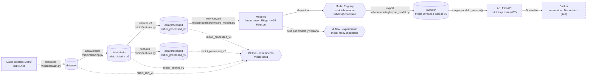

<p align="center">
  
</p>

<p align="center">
  <a href="https://github.com/LUISG47/mibici-demand/actions/workflows/ci.yml"></a>
  
  
  
  
  
  <a href="https://cookiecutter-data-science.drivendata.org/"></a>
  <a href="LICENSE"></a>
  
  
  
</p>

<p align="center"><b>Tecnológico de Monterrey</b> · MLOps (TC5061) · Equipo 1</p>

Pronóstico de demanda de bicicletas por estación y por hora con los
[datos abiertos de MiBici Guadalajara](https://mibici.net/en/open-data/). El objetivo es
anticipar qué estaciones van a quedar vacías o llenas para rebalancear bicicletas a tiempo.

## Equipo

| Integrante | Matrícula | Rol | GitHub |
|---|---|---|---|
| José Luis Lorenzo Augusto Galíndez Vences | A01105695 | Data Engineer / Líder técnico | [@LUISG47](https://github.com/LUISG47) |
| Dante Andreas Cosgaya Morán | A01370354 | Data Scientist | [@dacosgaya](https://github.com/dacosgaya) |
| Héctor Calderón Pérez | A01797600 | Data Scientist / ML Engineer | [@hector-calderon](https://github.com/hector-calderon) |
| Arturo Alejandro Flores Amaro | A01797429 | ML / Software Engineer | [@ArturoAmaro1801](https://github.com/ArturoAmaro1801) |

## Pipeline



Cada versión del dataset queda registrada en MLflow con su esquema, número de filas, *digest*
y los tags `git_commit` y `fuente_datos`, que la ligan al código y a la fuente que la generaron.
Los nodos con borde punteado (API y publicación en DockerHub) están en desarrollo.

Para generar los datasets procesados:

```bash
# Versión 2: dataset estación-hora con normalización histórica
python -m mibici.features v2

# Versión 3: variables sin escalar y objetivo de la siguiente hora
python -m mibici.features v3
```

## Estado del proyecto

| Fase | Estado | Entrega |
|---|---|---|
| Fase 1: datos, EDA y preprocesamiento | ✅ Completada | 25 de octubre de 2026 |
| Fase 2: modelado | ✅ Completada | 6 de noviembre de 2026 |
| Entrega final: pruebas, API, Docker y monitoreo | 🚧 En curso | 22 de noviembre de 2026 |

### Entrega final 🚧

- [x] Modelo exportado a `models/` y `Dockerfile` (#40, PR #43)
- [ ] Pruebas de integración de extremo a extremo (#38)
- [ ] API con FastAPI: `POST /predict` y `GET /health` (#37)
- [ ] Publicación de la imagen en DockerHub (#40)
- [ ] Simulación de data drift y detección de pérdida de performance (#39)
- [ ] README final y CI con GitHub Actions (#41)

<details>
<summary><b>Fase 2 ✅</b></summary>

- [x] `params.yaml`, validación walk-forward y tracking de MLflow (#26)
- [x] Dataset `mibici_processed_v3` y Pipeline de scikit-learn (#27, #28)
- [x] Parámetros del proyecto en `params.yaml` (#30, #31)
- [x] Líneas base, Ridge y HGB Poisson con ajuste de hiperparámetros, champion en el Model Registry (#32, #34)
- [x] Inferencia con `predict.py` y notebook de modelado (#33, #35, #36)

</details>

<details>
<summary><b>Fase 1 ✅</b></summary>

- [x] Estructura del proyecto con Cookiecutter Data Science
- [x] Ingesta de datos abiertos (`mibici/dataset.py`)
- [x] Diagnóstico de datos crudos (`notebooks/0.1-lg-diagnostico-raw.ipynb`, `reports/diagnostico_raw.md`)
- [x] Limpieza con `DataCleaner` y versionado de datos con MLflow (#4)
- [x] EDA (#14)
- [x] Preprocesamiento y `mibici_processed_v2` (#11, #13, #16)
- [x] Refactor POO y pruebas (#15, #17, #18)
- [x] Reporte PDF Fase 1 (#8)

</details>

Para colaborar, revisa [CONTRIBUTING.md](CONTRIBUTING.md).

## Configuración y validación

Los parámetros del proyecto (meses de datos, umbrales de limpieza, horizonte, rezagos,
meses de prueba, semilla, hiperparámetros y nombres de MLflow) viven en
[`params.yaml`](params.yaml) y se leen con `cargar_parametros()` de `mibici/config.py`.
Las rutas se siguen calculando en `config.py`.

La validación es **walk-forward con ventana creciente**: para cada mes de prueba
(abril a septiembre de 2026) se entrena con todo lo anterior y se evalúa en ese mes, con
MAE, RMSE y WAPE. Se quita del entrenamiento la última hora antes del mes de prueba,
porque su objetivo (la siguiente hora) ya cae en la prueba.

```python
from mibici.modeling.validation import WalkForwardSplitter, evaluar_walk_forward
from mibici.modeling.tracking import configurar_mlflow, registrar_evaluacion

splitter = WalkForwardSplitter.desde_parametros()  # también sirve como cv= en GridSearchCV
tabla, resumen = evaluar_walk_forward(pipeline, X, y, splitter)

configurar_mlflow()  # experimento mibici-fase2-modelado
run_id = registrar_evaluacion("ridge", tabla, resumen, hiperparametros)
```

En MLflow cada modelo tiene un run padre con las métricas promedio y un run anidado por
ventana. `registrar_modelo(run_id, ..., alias="champion")` lo registra como
`mibici-demanda-salidas` y se carga con `models:/mibici-demanda-salidas@champion`.

## Fase 2: modelado de principio a fin

Objetivo: predecir las salidas de cada estación en la siguiente hora. Con el `.venv`
activado y los viajes limpios en `data/interim/` (ver
[Limpieza y versionado](#limpieza-y-versionado-de-datos-con-mlflow)):

```bash
# 1. Dataset v3: variables sin escalar y objetivo de la siguiente hora
#    (data/processed/estacion_hora_v3.parquet, registrado como mibici_processed_v3)
python -m mibici.features v3

# 2. Comparar modelos y registrar el champion
python -m mibici.modeling.compare_models

# 3. Predecir con el champion (data/processed/predicciones.parquet)
python -m mibici.modeling.predict

# 4. Revisar runs, métricas y Model Registry (http://127.0.0.1:5000)
mlflow ui --backend-store-uri sqlite:///$PWD/mlflow.db
```

- **`compare_models`** evalúa con walk-forward (abril a septiembre de 2026) las dos líneas
  base (misma hora de la semana anterior y media por estación × día × hora), Ridge y
  HistGradientBoosting con pérdida Poisson. Ridge y HGB se ajustan dentro de cada ventana
  con el espacio de `params.yaml`. Cada modelo queda en el experimento
  `mibici-fase2-modelado` con un run padre (métricas promedio e hiperparámetros más
  elegidos) y un run anidado por ventana. El de menor MAE promedio se entrena con todo el
  periodo y se registra como `mibici-demanda-salidas@champion`.
- La corrida completa tarda unos 20 minutos y usa hasta ~9 GB de RAM. El avance del HGB se
  guarda en `data/processed/checkpoints_hgb/`; si se interrumpe, se puede volver a correr y
  continúa donde se quedó.
- **`predict`** carga `models:/<modelo_registrado>@champion` (nombre de `params.yaml`) y
  guarda `estacion_id`, `fecha_hora`, `fecha_objetivo`, las salidas reales (si vienen en
  los datos) y las predichas, recortadas en 0. Acepta `--datos-path`, `--salida-path`
  (`.parquet` o `.csv`), `--alias`, `--modelo-nombre` y `--modelo-dir` (usa un modelo
  exportado en `models/` en lugar del Registry; ver [Modelo desplegable](#modelo-desplegable)).
- El notebook [`notebooks/2.0-aaf-modelado.ipynb`](notebooks/2.0-aaf-modelado.ipynb)
  muestra la comparación registrada en MLflow y predice con el champion; se ejecuta
  después del paso 2.

## Instalación

```bash
python3 -m venv .venv
source .venv/bin/activate
pip install -r requirements.txt
```

## Descarga de datos

Los datos vienen de los [datos abiertos de MiBici](https://mibici.net/en/open-data/) y **no se
suben a Git**. Para bajarlos a `data/raw/` (con el `.venv` activado):

```bash
# Rango por defecto: 2025-10 a 2026-09
python mibici/dataset.py

# Otro rango de meses (formato AAAA-MM, ambos inclusive)
python mibici/dataset.py --inicio 2025-01 --fin 2025-06

# Equivalente con make (usa el rango por defecto)
make data
```

- Baja un CSV de viajes por mes (`datos_abiertos_AAAA_MM.csv`) y el CSV de nomenclatura de
  estaciones (`nomenclatura_AAAA_MM.csv`).
- Los enlaces se extraen de la página de datos abiertos, porque no siguen un patrón fijo.
- Omite los archivos que ya están descargados, así que se puede volver a correr sin problema.
- Avisa en consola qué meses del rango no tienen enlace (por ejemplo, meses aún no publicados).
- Las carpetas de `data/` se crean solas la primera vez (`mibici/config.py`).
- También se puede usar desde Python: `from mibici.dataset import descargar_meses`.

## Limpieza y versionado de datos con MLflow

```bash
python -m mibici.cleaning                                  # limpia y registra en MLflow
mlflow ui --backend-store-uri sqlite:///$PWD/mlflow.db     # abrir http://127.0.0.1:5000
```

El script lee todos los CSV de `data/raw/`, aplica la clase `DataCleaner` (`mibici/cleaning.py`)
y guarda el resultado en `data/interim/viajes_limpios.parquet`. Todo queda en el experimento
**`mibici-fase1`** de MLflow (base `mlflow.db` y artefactos en `mlruns/`, ambos fuera de Git):

- Dataset crudo **`mibici_raw_v1`** (`context="raw"`) y dataset limpio **`mibici_interim_v1`**
  (`context="interim"`), con su esquema, número de filas y *digest* para detectar cambios.
- Parámetros: meses procesados y filas antes y después.
- Artefacto `bitacora_limpieza.csv`: por cada regla, filas antes, después y afectadas.
- Artefacto `datos/viajes_limpios.parquet`: copia del dataset limpio (~96 MB por corrida). El
  crudo no se guarda porque se reconstruye con `mibici/dataset.py`.
- Tags que ligan cada versión de los datos con su origen: `git_commit` (hash del código que la
  generó), `git_cambios_sin_commit` (`true` si se corrió con cambios sin commit, en cuyo caso
  el hash no describe exactamente el código) y `fuente_datos` (URL de los datos abiertos).

Para que `git_commit` sea confiable, haz commit de tus cambios **antes** de correr la limpieza.

### Reglas, en el orden en que se aplican

Los números vienen del diagnóstico (`reports/diagnostico_raw.md`). En la lectura, cada archivo
se abre como UTF-8 y, si falla, como Latin-1 (caso de 2026-01).

| # | Regla (método) | Qué hace | Por qué |
|---|---|---|---|
| 1 | `eliminar_duplicados` | Quita filas idénticas | 758 filas repetidas en 2026-09; contarían doble la demanda |
| 2 | `parsear_fechas` | Inicio y fin a datetime, agrega `duracion_min` | Las reglas de duración y el conteo por hora lo necesitan |
| 3 | `eliminar_duracion_cero` | Quita viajes de 0 segundos | Terminan en el mismo instante en que empiezan: no son viajes |
| 4 | `eliminar_cortos_misma_estacion` | Quita viajes < 1 min con origen = destino | La bici se sacó y se devolvió de inmediato (anclaje fallido o arrepentimiento); no es demanda real |
| 5 | `eliminar_mas_de_24h` | Quita viajes de más de 24 h | Bicicletas no devueltas o errores de registro (13 viajes, máximo 98 h) |
| 6 | `marcar_duracion_atipica` | `duracion_atipica = True` si dura de 3 a 24 h | Son raros (p99.9 = 59 min) pero la salida sí ocurrió; se conservan y se pueden excluir en el EDA |
| 7 | `anio_nacimiento_invalido_a_nulo` | Año < 1920 pasa a nulo | Años imposibles (199, 1420); el viaje es válido, solo el dato del usuario no |
| 8 | `genero_nulo_a_desconocido` | Género vacío pasa a `"desconocido"` | Conserva los viajes (0.7%) y deja explícita la categoría |
| 9 | `marcar_estaciones_en_catalogo` | `estacion_en_catalogo = True` si origen y destino están en la nomenclatura | Las estaciones 405 y 407 no están en el catálogo pero tuvieron viajes reales (junio y julio 2026); se conservan |

En las reglas que marcan o corrigen, "filas afectadas" en la bitácora cuenta las filas
modificadas; en la regla 9 cuenta los viajes **fuera** del catálogo.

Resultado con 2025-10 a 2026-09: **4,497,877 → 4,354,416 viajes** (se elimina el 3.2%).

## Pruebas

Todas las pruebas corren con un solo comando desde la raíz del repo (con el `.venv`
activado). **No necesitan `data/` ni `mlflow.db`**: usan datos sintéticos, fixtures
pequeños en `tests/fixtures/` y un MLflow temporal en cada prueba, así que también
corren en un clon limpio y en el CI.

```bash
pytest -q        # todas las pruebas (~30 s)
make lint        # ruff: formato e imports
make test        # equivalente a python -m pytest tests
```

| Grupo | Archivos | Qué cubre |
|---|---|---|
| Datos | `test_cleaning.py`, `test_diagnostics.py`, `test_eda.py`, `test_features.py`, `test_plots.py` | Reglas de `DataCleaner`, diagnóstico de crudos, EDA, agregación estación-hora (v2 y v3) y gráficas |
| Modelado | `test_modeling_pipeline.py`, `test_baselines.py`, `test_validation.py`, `test_tuning.py`, `test_checkpoints.py` | Pipeline de scikit-learn, líneas base, walk-forward y métricas, ajuste de hiperparámetros y checkpoints |
| Evaluación | `test_compare_models.py`, `test_error_analysis.py`, `test_error_plots.py` | Comparación de modelos y elección del champion, análisis y figuras de errores |
| MLflow | `test_tracking.py`, `test_predict.py` | Runs padre y anidados, Model Registry con alias, inferencia y CLI de `predict` |
| Serving | `test_export_model.py` | Exportación a `models/` con `metadata.json` y reproducibilidad del modelo v1 (tolerancia 1e-9) |

El workflow [`.github/workflows/ci.yml`](.github/workflows/ci.yml) corre `make lint` y
`pytest -q` con Python 3.12.2 en cada Pull Request y en cada push a `main`.

## Modelo desplegable

El modelo que se sirve es **`models:/mibici-demanda-salidas/1`**: el champion de la
Fase 2 (HistGradientBoosting con pérdida Poisson, MAE promedio 0.750 en el walk-forward
de abril a septiembre de 2026). Está exportado como modelo MLflow en
[`models/mibici-demanda-salidas-v1/`](models/mibici-demanda-salidas-v1/), que **sí se
versiona en Git** (1.8 MB): así cualquiera que clone el repo, el CI y la imagen Docker lo
tienen sin acceso a nuestro `mlflow.db` local.

| Archivo | Contenido |
|---|---|
| `MLmodel`, `model.pkl` | Modelo MLflow (Pipeline de scikit-learn serializado con cloudpickle) y su firma de 20 columnas |
| `requirements.txt`, `conda.yaml`, `python_env.yaml` | Entorno con el que se entrenó |
| `input_example.json`, `serving_input_example.json` | Ejemplos de entrada |
| `metadata.json` | URI y versión del modelo, `run_id`, métricas promedio, hiperparámetros, `git_commit` del entrenamiento y de la exportación, `fecha_exportacion`, `columnas_entrada` y `sha256_model_pkl` |

Para exportarlo de nuevo desde el Model Registry (necesita `mlflow.db`):

```bash
python -m mibici.modeling.export_model                 # usa la sección serving: de params.yaml
python -m mibici.modeling.export_model --sobrescribir  # si la carpeta ya existe
```

Desde Python, `cargar_modelo_servicio()` de `mibici/modeling/predict.py` carga el modelo
según `serving.fuente` de `params.yaml`: `local` (la carpeta de `models/`, lo que usa
Docker) o `registry` (`models:/<nombre>/<versión>`).

## Docker

La imagen se construye con [`Dockerfile`](Dockerfile) sobre `python:3.12.2-slim`, instala
solo [`requirements-serving.txt`](requirements-serving.txt), corre con un usuario sin
privilegios y copia el modelo de `models/` (nunca `data/`, `mlruns/` ni `mlflow.db`; ver
[`.dockerignore`](.dockerignore)).

```bash
docker build -t ml-service:latest .
docker run -p 8000:8000 ml-service:latest
```

> El contenedor arranca la API (`uvicorn mibici.api.main:app` en el puerto 8000) cuando se
> integre el servicio del #37; mientras tanto la imagen ya construye y reproduce las
> predicciones de `predict.py`. La liga de DockerHub se agregará al publicar la imagen (#40).

## Project Organization

```
├── .github/workflows/ci.yml   <- CI: lint y pruebas en cada PR y push a main
├── .dockerignore              <- Lo que no entra a la imagen (datos, MLflow, notebooks, pruebas)
├── CLAUDE.md                  <- Contexto y reglas del proyecto para asistentes de IA
├── CONTRIBUTING.md            <- Guía para colaborar: entorno, datos, ramas y Pull Requests
├── Dockerfile                 <- Imagen de servicio (python:3.12.2-slim, usuario no root)
├── LICENSE                    <- Licencia MIT
├── Makefile                   <- Comandos: make requirements, data, lint, format, test
├── README.md                  <- Este documento
├── params.yaml                <- Parámetros: datos, limpieza, features, validación, modelado, MLflow y serving
├── pyproject.toml             <- Metadatos del paquete mibici y configuración de ruff y pytest
├── requirements.txt           <- Dependencias fijas del entorno de desarrollo
├── requirements-serving.txt   <- Dependencias mínimas para servir el modelo (imagen Docker)
│
├── docs
│   └── assets/banner.svg      <- Banner del README
│
├── mibici                     <- Código fuente del proyecto
│   ├── __init__.py            <- Hace de mibici un módulo de Python
│   ├── config.py              <- Rutas, MLflow y cargar_parametros() de params.yaml
│   ├── dataset.py             <- Descarga de los datos abiertos de MiBici a data/raw
│   ├── diagnostics.py         <- Diagnóstico de los datos crudos
│   ├── cleaning.py            <- DataCleaner y versionado de los datos con MLflow
│   ├── eda.py                 <- Análisis exploratorio
│   ├── features.py            <- Agregación estación-hora y datasets v2 y v3
│   ├── plots.py               <- Gráficas del EDA
│   └── modeling
│       ├── __init__.py
│       ├── pipeline.py        <- Pipeline de scikit-learn (imputación, escalado, TargetEncoder)
│       ├── validation.py      <- Walk-forward de ventana creciente y métricas MAE, RMSE y WAPE
│       ├── baselines.py       <- Líneas base (semana anterior y media por estación × día × hora)
│       ├── evaluate_baselines.py <- Evaluación walk-forward de las líneas base
│       ├── tuning.py          <- Ajuste de hiperparámetros con validación temporal
│       ├── checkpoints.py     <- Checkpoints del entrenamiento de HGB para poder reanudar
│       ├── train.py           <- Entrenamiento y evaluación de modelos
│       ├── compare_models.py  <- Comparación de modelos y registro del champion en MLflow
│       ├── tracking.py        <- Runs padre y anidados en MLflow y Model Registry
│       ├── error_analysis.py  <- Diagnóstico de errores de HGB Poisson
│       ├── error_plots.py     <- Figuras de errores por estación, hora y extremos
│       ├── predict.py         <- Inferencia por lotes y carga del modelo para servir
│       └── export_model.py    <- Exportación del modelo registrado a models/
│
├── models
│   └── mibici-demanda-salidas-v1  <- Modelo desplegable (MLflow) con metadata.json
│
├── notebooks
│   ├── 0.1-lg-diagnostico-raw.ipynb  <- Diagnóstico de los datos crudos
│   ├── 1.0-dac-eda.ipynb             <- Análisis exploratorio
│   └── 2.0-aaf-modelado.ipynb        <- Comparación de modelos y predicción con el champion
│
├── references                 <- Material de referencia (vacía por ahora)
│
├── reports
│   ├── diagnostico_raw.md     <- Hallazgos del diagnóstico de los datos crudos
│   ├── preprocesamiento.md    <- Decisiones de preprocesamiento
│   └── figures                <- Figuras del EDA (eda_*.png) y del análisis de errores (hgb_*.png)
│
└── tests                      <- Pruebas con pytest (ver Pruebas)
    ├── fixtures               <- Muestra fija de 1,000 filas del v3 y sus predicciones esperadas
    └── test_*.py              <- Pruebas unitarias de los módulos de mibici
```

`data/` (crudos, intermedios y procesados), `mlflow.db` y `mlruns/` se generan localmente
y no se suben a Git: los datos se versionan en MLflow.

--------
