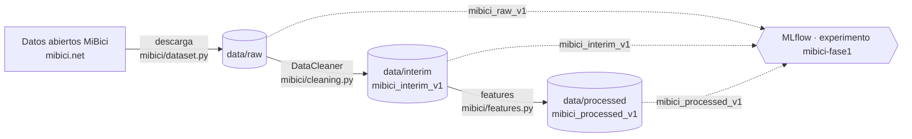

<p align="center">
  
</p>

<p align="center">
  
  
  
  
  <a href="https://cookiecutter-data-science.drivendata.org/"></a>
  <a href="LICENSE"></a>
  
</p>

<p align="center"><b>Tecnológico de Monterrey</b> · MLOps (TC5061) · Equipo 1</p>

Pronóstico de demanda de bicicletas por estación y por hora con los
[datos abiertos de MiBici Guadalajara](https://mibici.net/en/open-data/). El objetivo es
anticipar qué estaciones van a quedar vacías o llenas para rebalancear bicicletas a tiempo.

## Equipo

| Integrante | Matrícula | Rol | GitHub |
|---|---|---|---|
| José Luis Lorenzo Augusto Galíndez Vences | A01105695 | Data Engineer / Líder técnico | [@LUISG47](https://github.com/LUISG47) |
| Dante Andreas Cosgaya Morán | A01370354 | Data Scientist | [@dacosgaya](https://github.com/dacosgaya) |
| Héctor Calderón Pérez | A01797600 | Data Scientist / ML Engineer | [@hector-calderon](https://github.com/hector-calderon) |
| Arturo Alejandro Flores Amaro | A01797429 | ML / Software Engineer | (pendiente) |

## Pipeline



Cada versión del dataset queda registrada en MLflow con su esquema, número de filas, *digest*
y los tags `git_commit` y `fuente_datos`, que la ligan al código y a la fuente que la generaron.

## Avance Fase 1

Entrega: 25 de octubre de 2026.

- [x] Estructura del proyecto con Cookiecutter Data Science
- [x] Ingesta de datos abiertos (`mibici/dataset.py`)
- [x] Diagnóstico de datos crudos (`notebooks/0.1-lg-diagnostico-raw.ipynb`, `reports/diagnostico_raw.md`)
- [x] Limpieza con `DataCleaner` y versionado de datos con MLflow (#4)
- [ ] EDA (#5)
- [ ] Preprocesamiento y `mibici_processed_v1` (#6)
- [ ] Refactor POO y pruebas (#7)
- [ ] Reporte PDF Fase 1 (#8)

Para colaborar, revisa [CONTRIBUTING.md](CONTRIBUTING.md).

## Instalación

```bash
python3 -m venv .venv
source .venv/bin/activate
pip install -r requirements.txt
```

## Descarga de datos

Los datos vienen de los [datos abiertos de MiBici](https://mibici.net/en/open-data/) y **no se
suben a Git**. Para bajarlos a `data/raw/` (con el `.venv` activado):

```bash
# Rango por defecto: 2025-10 a 2026-09
python mibici/dataset.py

# Otro rango de meses (formato AAAA-MM, ambos inclusive)
python mibici/dataset.py --inicio 2025-01 --fin 2025-06

# Equivalente con make (usa el rango por defecto)
make data
```

- Baja un CSV de viajes por mes (`datos_abiertos_AAAA_MM.csv`) y el CSV de nomenclatura de
  estaciones (`nomenclatura_AAAA_MM.csv`).
- Los enlaces se extraen de la página de datos abiertos, porque no siguen un patrón fijo.
- Omite los archivos que ya están descargados, así que se puede volver a correr sin problema.
- Avisa en consola qué meses del rango no tienen enlace (por ejemplo, meses aún no publicados).
- Las carpetas de `data/` se crean solas la primera vez (`mibici/config.py`).
- También se puede usar desde Python: `from mibici.dataset import descargar_meses`.

## Project Organization

```
├── LICENSE            <- Open-source license if one is chosen
├── Makefile           <- Makefile with convenience commands like `make data` or `make train`
├── README.md          <- The top-level README for developers using this project.
├── data
│   ├── external       <- Data from third party sources.
│   ├── interim        <- Intermediate data that has been transformed.
│   ├── processed      <- The final, canonical data sets for modeling.
│   └── raw            <- The original, immutable data dump.
│
├── docs               <- A default mkdocs project; see www.mkdocs.org for details
│
├── models             <- Trained and serialized models, model predictions, or model summaries
│
├── notebooks          <- Jupyter notebooks. Naming convention is a number (for ordering),
│                         the creator's initials, and a short `-` delimited description, e.g.
│                         `1.0-jqp-initial-data-exploration`.
│
├── pyproject.toml     <- Project configuration file with package metadata for 
│                         mibici and configuration for tools like black
│
├── references         <- Data dictionaries, manuals, and all other explanatory materials.
│
├── reports            <- Generated analysis as HTML, PDF, LaTeX, etc.
│   └── figures        <- Generated graphics and figures to be used in reporting
│
├── requirements.txt   <- The requirements file for reproducing the analysis environment, e.g.
│                         generated with `pip freeze > requirements.txt`
│
├── setup.cfg          <- Configuration file for flake8
│
└── mibici   <- Source code for use in this project.
    │
    ├── __init__.py             <- Makes mibici a Python module
    │
    ├── config.py               <- Store useful variables and configuration
    │
    ├── dataset.py              <- Scripts to download or generate data
    │
    ├── features.py             <- Code to create features for modeling
    │
    ├── modeling                
    │   ├── __init__.py 
    │   ├── predict.py          <- Code to run model inference with trained models          
    │   └── train.py            <- Code to train models
    │
    └── plots.py                <- Code to create visualizations
```

--------

